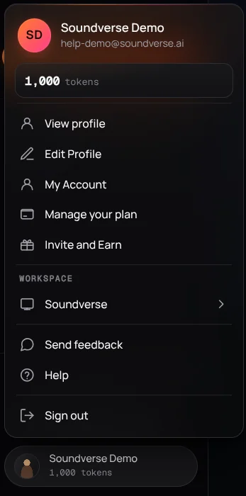
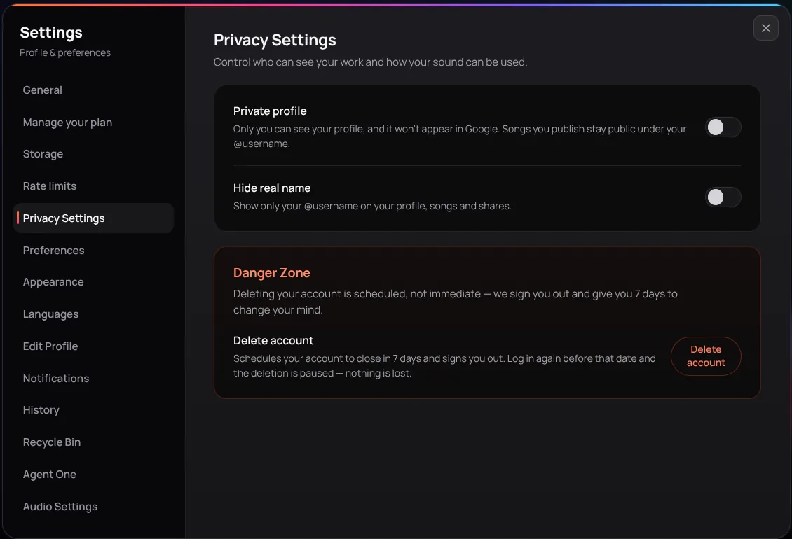

## Your account menu

Click your name or picture at the bottom of the left sidebar to open your account menu:

| Item | What it does |
| --- | --- |
| View profile | Open your public profile page |
| Edit Profile | Edit your public profile: bio, links and tags |
| My Account | Open your settings (see below) |
| Manage your plan | See your plan and tokens, buy top-ups, upgrade or cancel |
| Invite and Earn | Invite friends and earn tokens when they join |
| Workspace | Switch between your personal workspace and any team workspace you belong to |
| Send feedback | Tell us about a bug or an idea |
| Help | Open the help center |
| Sign out | Sign out of Soundverse |

The menu also shows how many tokens you have left.

<Frame>
  
</Frame>

## Settings

Choose **My Account** to open your settings. You can also go straight to a tab with a link like `https://www.soundverse.ai/account?tab=plan`.

| Tab | What you can do there |
| --- | --- |
| General | Your profile picture, name and username, and how you sign in |
| Manage your plan | Your plan and token balance, **Upgrades & top-ups** (buy extra tokens), plan comparison, **Billing history** and **Cancel plan** |
| Storage | See how much storage you use, and find and remove large files |
| Rate limits | How much of each tool you've used this month against your plan's limits |
| Privacy Settings | Make your profile private, hide your real name, and delete your account |
| Preferences | Control what the agent will generate for you, including the NSFW filter and Unhinged mode |
| Appearance | Choose the app's theme |
| Languages | Choose the app's language |
| Edit Profile | Your public profile: bio, links and tags |
| Notifications | Choose which emails and alerts you get |
| History | Your past generations |
| Recycle Bin | Restore recently deleted tracks, videos and images, or delete them forever |
| Agent One | How autonomous Agent One is allowed to be, in chat, AI Studio and workflows |
| Audio Settings | Choose your microphone and speakers |

<Frame>
  
</Frame>

## Invite and Earn

Choose **Invite and Earn** from your account menu. Share your invite link, or email invites to up to 30 people at once. When a friend joins through your link, you both earn tokens. The window shows how many people have joined and how many tokens you've earned.

## Send feedback

Choose **Send feedback** from your account menu to report a bug or suggest an idea. For billing or account problems, you can also email support@soundverse.ai.

## Delete your account

Go to **My Account** → **Privacy Settings** and use the **Danger Zone** at the bottom. Your account is scheduled to close in 7 days and you're signed out. Sign in again before that date and the deletion is paused, with nothing lost.
