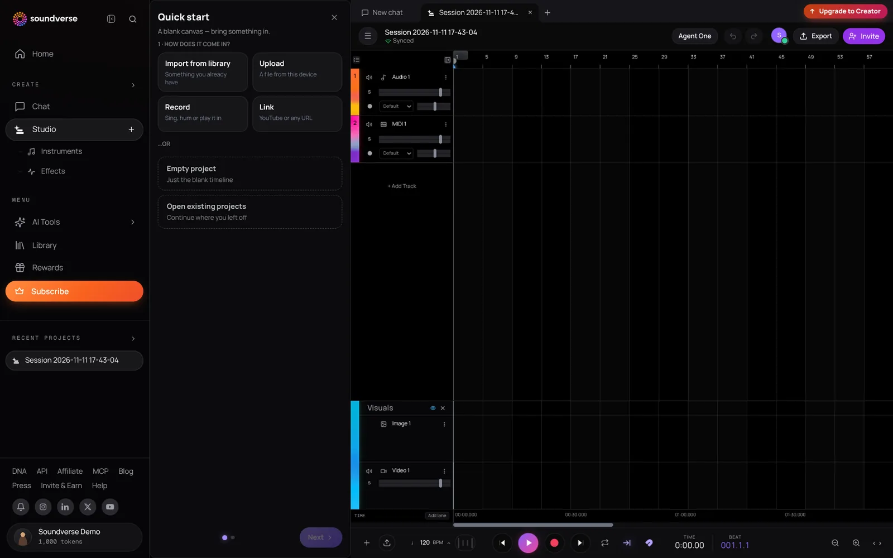

## What is AI Studio?

AI Studio is Soundverse's multitrack studio. It runs in your browser and puts audio, MIDI, video and image tracks on one timeline, with AI generation built in. Record your voice, play the built-in instruments, generate songs, vocals, sound effects and video onto the timeline, then mix, master and export, on your own or with collaborators.

You get:

- Eight built-in instruments and 28 effects
- A Mixer, Mix One and Mastering One
- AI tools on every track and clip
- Agent One in the top bar, to edit the project for you
- Real-time collaboration with comments, chat and calls
- Export to audio, stems or video

## Getting started

1. Click **Studio** in the left sidebar. It opens your latest project, or a new one with a **Quick start** panel for importing, uploading or recording your first file.
2. Click **Add Track** and choose **Audio Track** or **MIDI Track**. You can also click **Upload**, drag files onto the timeline, or add files from your Soundverse Library.
3. To record, arm a track and press **Record**.

AI Studio imports audio (MP3, WAV, OGG, M4A, AAC), video (MP4, MOV, WebM, MKV, AVI) and images. You need the rights to anything you upload.

<Frame>
  
</Frame>

## The Studio screen

- **Studio menu** (top left): start, duplicate or import into a project; open the Visualizer, Mixer and Mix One; show the video player; invite collaborators; export; replay the AI Studio tour; and switch layouts (Ideation, Songwriting, Music Production, Beat Making, Sound Design, Recording, Mixing, Music Video, File Navigation).
- **Top bar**: Agent One, undo and redo, Chat, Invite and Export.
- **Transport bar** (bottom): Add Track, Upload, metronome, tempo (BPM), snap, loop, follow playhead and zoom.
- **Timeline**: your tracks and clips. Audio and MIDI tracks sit above the visual lanes for video, images and titles.

## Generate with AI on the timeline

- **On an empty part of an audio track**: right-click and choose **Generate Instrumental**, **Song**, **Vocals**, **SFX** or **Dialogue**. Click **Generate in Studio** and the result lands on the timeline.
- **On a clip**: right-click it and open **AI Tools** to remix it, swap the voice, turn a voice into an instrument, generate a matching stem, make a similar song, turn a melody into a song, or extend it.
- **On part of a clip**: select a range and regenerate just that section (inpainting).
- **On a video clip**: right-click it to generate sound effects or music for the video, describe it with AI, or unlink its audio.

AI tools use tokens. Some need the Creator plan or above, and each tool shows its price before it runs.

## Instruments and effects

While you're in AI Studio, the **Studio** item in the left sidebar expands to **Instruments** and **Effects**. Open **Instruments** to load an instrument onto a MIDI track:

- Synth One
- Bass One
- Drum Kit One (16 pads)
- Sampler One
- Guitar One
- Chord One
- Visual One (play with hand gestures)
- VocalMIDI One

MIDI tracks open in a piano roll for editing notes.

Open **Effects** to add any of 28 effects to a track, including EQ, reverb, delay, compressor, limiter, saturation, chorus, phaser, auto-filter, widener, sidechain, vocal tuning, de-esser, and character effects such as Vinyl One, Cassette One and Stutter One. Automation lanes let you change a setting over time.

AI Studio's instruments and effects are built in; it doesn't load third-party VST or AU plugins.

## Mixing and mastering

- **Mixer**: balance levels and panning for every track.
- **Mix One** (Studio menu): an AI mix of your project.
- **Mastering One**: master the whole song from the master track.

## Recording

Arm one or more tracks, choose your input, and press **Record**. Recording has no count-in or punch-in, so start playback a bar early if you need a lead-in.

## Video, images and titles

Drag a video or image onto the timeline, or generate one, and it lands on a visual lane. Add titles and subtitles on the text lane over your video. Trim and split visual clips like audio clips, and use the video player to preview your edit in sync with the music.

## Agent One in AI Studio

Click **Agent One** in the top bar and leave its Studio switch on. Agent One then edits the project live, as a collaborator with its own AI-marked avatar: it can add tracks and MIDI parts, write notes, choose instruments and effects, set the tempo and arrange clips.

## Collaborate

1. Click **Invite** in the top bar (or **Invite collaborators** in the Studio menu). The project owner and Admins can invite people.
2. Type the email of someone who already uses Soundverse and pick a role (**Admin**, **Editor** or **Viewer**), or set **General Access** to **Anyone with link** and choose **Can view** or **Can edit**.
3. Everyone works on the same timeline at once, with named cursors.

Right-click an empty part of a track and choose **Comment** to pin a note at that bar. Once someone has joined, click **Chat** to message the session, @mention people and share files, and start an audio or video call with up to three people who are online.

<Note>
The Viewer role and Can view links don't make the timeline read-only, so only invite people you'd trust to edit. Roles can't be changed after an invite: remove the person and invite them again.
</Note>

A shared project's track limit follows the owner's plan. Each collaborator's AI tools and export options follow their own plan.

## Export

Click **Export** and choose a tab:

- **Audio**: WAV, MP3, FLAC, AAC or OGG, with sample rate, bit depth and an optional loudness target (Streaming −14 LUFS, Club −9, Broadcast −23). You can export just a selected time range.
- **Stems**: a ZIP with one file per track, with each track's effects baked in or not.
- **Video**: MP4, WebM or MOV, from 720p up to 4K.

To save a single clip, right-click it and choose **Export File** (or **Export as MIDI File** for a MIDI clip). Exporting in the browser is blocked for projects longer than 15 minutes or with more than 24 tracks.

## Plan limits

| | Free | Creator | Pro |
| --- | --- | --- | --- |
| Projects | 3 | 8 | 20 |
| Tracks per project | 3 | 8 | 20 |
| Audio export | MP3 | + WAV, FLAC, AAC, OGG | + WAV, FLAC, AAC, OGG |
| Stems export | No | Yes | Yes |
| Video export | 720p | Up to 1080p | Up to 4K |

Max plans raise the limits further. See [pricing](https://www.soundverse.ai/pricing).
