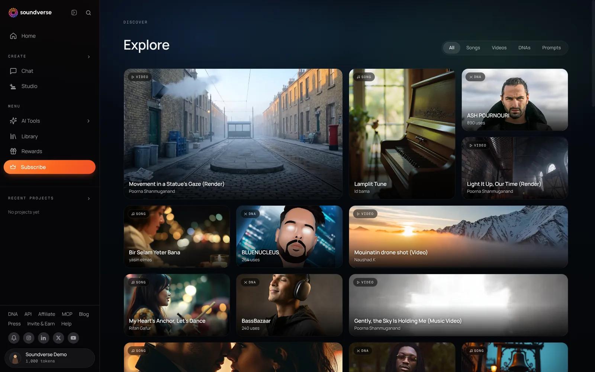
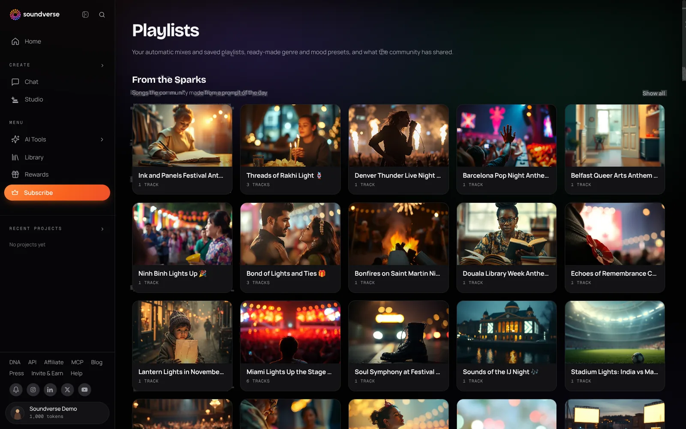

## Explore

Explore shows what the Soundverse community is making: songs, videos, Artist DNAs and prompts. Go to [soundverse.ai/explore](https://www.soundverse.ai/explore), and use the filters at the top (**All**, **Songs**, **Videos**, **DNAs**, **Prompts**) to narrow it down.

Play anything, open a track to see its page and its creator, like it, or save it to your Library.

<Frame>
  
</Frame>

## Sparks

Sparks are song ideas for what's happening now: festivals, events and moments, picked for your country. You'll find them on **Home**, under **Sparks · trending today**; click **See all sparks** for the rest. Choose a Spark, customize the idea if you like, and create a song from it.

## Playlists

Go to [soundverse.ai/playlists](https://www.soundverse.ai/playlists) for:

- **Made for you**: Recently Played, On Repeat and Made For You, built from what you listen to.
- **Created by you**: playlists you've made.
- **From the Sparks**: songs the community made from each Spark.
- Ready-made genre and mood playlists, and what the community has shared.

Your playlists are also in your Library under **Playlists**.

<Frame>
  
</Frame>

## Keeping your songs private

Songs made on the Free plan are published publicly by default. To hide a song, open its menu in your Library and choose **Make Private**. To hide your whole profile, see [Make Your Profile Private](/account/private-profile).
