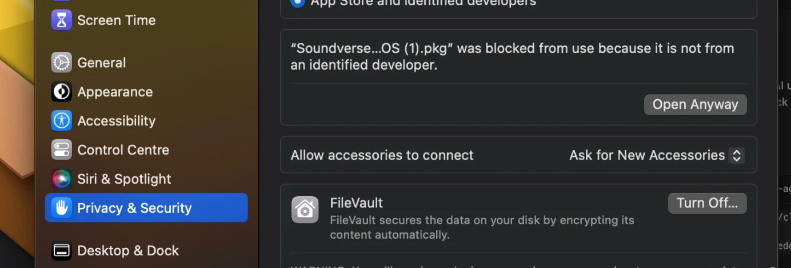

Download the installer for your computer from [soundverse.ai/features/vst-plugin](https://www.soundverse.ai/features/vst-plugin). Quit your DAW before you install.

## Mac

1. Open the downloaded `.pkg` file.
2. The beta installer isn't signed with an Apple Developer ID yet, so macOS stops it the first time with *"Soundverse…pkg" can't be opened* or *Apple can't check it for malicious software*. Click **OK** (or **Done**).
3. Open **System Settings › Privacy & Security** and scroll down to **Security**. You'll see *"Soundverse…pkg" was blocked from use because it is not from an identified developer*. Click **Open Anyway**.

<Frame>
  
</Frame>

4. Enter your Mac password if asked, then click **Open** in the next dialog.
5. Follow the installer. **Continue** › **Install** installs everything: the three VST3 plug-ins, the Audio Unit, CLAP and the standalone app. Click **Customize** to pick formats.
6. When it says *Soundverse AI VST is installed*, open your DAW and [find the plug-in](/plugin/daws). You can move the installer to the Bin.

Files go to the standard folders every DAW scans:

| Format | Folder |
|---|---|
| VST3 | `/Library/Audio/Plug-Ins/VST3` |
| Audio Unit | `/Library/Audio/Plug-Ins/Components` |
| CLAP | `/Library/Audio/Plug-Ins/CLAP` |
| App | `/Applications/Soundverse.app` |

## Windows

1. Open the downloaded `Soundverse-…-Windows-Setup.exe`.
2. The beta installer isn't code-signed yet, so Windows SmartScreen may show *Windows protected your PC*. Click **More info**, then **Run anyway**.
3. Allow the installer to make changes, choose **Everything (recommended)** and click **Install**. It also installs Microsoft WebView2 if your PC doesn't have it.
4. The last page shows where to find the plug-in in each DAW.

Plug-ins go to `C:\Program Files\Common Files\VST3` (and `…\CLAP`). To uninstall, use **Settings › Apps › Installed apps › Soundverse AI VST › Uninstall**.

## Linux

Install the `.deb` with your package manager, for example:

```bash
sudo apt install ./soundverse_*_amd64.deb
```

Plug-ins go to `/usr/lib/vst3` and `/usr/lib/clap`.

## Uninstall on Mac

There's no uninstaller app on Mac yet. Quit your DAW, open **Terminal** and run:

```bash
sudo rm -rf "/Library/Audio/Plug-Ins/VST3/Soundverse.vst3" "/Library/Audio/Plug-Ins/VST3/Soundverse Instrument.vst3" \
  "/Library/Audio/Plug-Ins/VST3/Soundverse FX.vst3" "/Library/Audio/Plug-Ins/Components/Soundverse.component" \
  "/Library/Audio/Plug-Ins/CLAP/Soundverse.clap" "/Applications/Soundverse.app"
for p in $(pkgutil --pkgs | grep ai.soundverse); do sudo pkgutil --forget "$p"; done
```

This removes the plug-ins from your Mac only. Your plugins and Library on soundverse.ai aren't touched.
